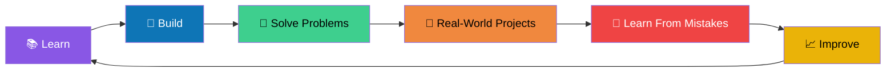

<!-- ===================== HEADER ===================== -->

 

---

## 👋 About Me

I'm a **B.Tech student and Full Stack Developer** passionate about building **real-world applications, solving problems, and continuously learning modern technologies**.

I enjoy building applications from the ground up — designing user interfaces, developing backend APIs, working with databases, implementing authentication, and turning ideas into practical software.

- 🎓 B.Tech Student
- 💻 Full Stack Developer (MERN + MySQL)
- ☕ Solving **Data Structures & Algorithms** using Java
- 🤖 Exploring **AI & Large Language Models**
- 🏢 Interested in **B2B software and SaaS products**
- 🚀 Focused on building practical and scalable solutions

 

---

## 🛠️ Tech Stack

### 💻 Languages

### 🌐 Frontend

### ⚙️ Backend

### 🗄️ Databases

### 🔧 Tools

---

## 🚀 Featured Projects

<table>
<tr>
<td width="50%" valign="top">

### 👔 Browear
**Men's Fashion E-Commerce Platform**

A full-stack e-commerce platform delivering a modern online shopping experience for men's fashion.

**✨ Features**
- 🔐 JWT authentication & user management
- 🛍️ Product browsing & discovery
- 🛒 Shopping cart & order management
- 💳 Complete e-commerce workflow
- 📱 Responsive UI
- 🔗 REST API integration

**🛠️ Stack**

</td>
<td width="50%" valign="top">

### 📦 Courier Management & Parcel Tracking
**Full-Stack Courier Business Platform**

A centralized system for courier businesses to manage customers, shipments, tracking, and deliveries.

**✨ Features**
- 👤 Customer management
- 📦 Shipment booking & lifecycle management
- 🔍 Real-time parcel tracking & history
- 👨‍💼 Admin dashboard
- 🔐 Authentication & authorization
- 📱 Responsive interface

**🛠️ Stack**

</td>
</tr>
</table>

---

## 🧠 Data Structures & Algorithms

I'm actively sharpening my problem-solving through **DSA practice in Java**, focusing on patterns, time/space complexity, and efficient solutions.

---

## 🤖 AI & Large Language Models

I'm exploring how AI can be integrated into real-world applications. My goal: combine **Full Stack Development + AI** to build products that solve real business problems.

| 🤖 Generative AI | 🧠 LLMs | 💬 AI Chatbots |
|:---:|:---:|:---:|
| **🔗 AI API Integration** | **⚙️ AI Automation** | **🏢 AI-powered B2B / SaaS** |

---

## 🎯 Currently Working On

---

## 📈 Development Journey

---

## 📊 GitHub Stats

 

 

---

## 🐍 Contribution Snake

<!-- Requires the Platane/snk GitHub Action — see note below the README setup -->

---

## 💡 Interests

---

## 🤝 Let's Connect

  

**Building interesting products • Learning new technologies • Solving challenging problems • Collaborating on meaningful projects**

 

